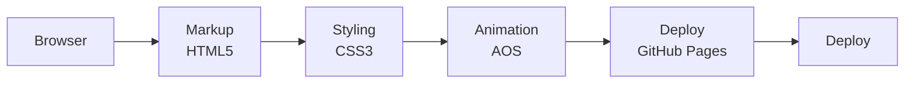

<h1 align="center">Prospark — Marketing Agency Template</h1>

<p align="center"><b>A two-page marketing agency template with scroll-triggered animations and a dedicated service page.</b></p>

<p align="center">
<a href="https://mister2314.github.io/Prospark-template/"></a>


</p>

<p align="center"><a href="https://mister2314.github.io/Prospark-template/"><b>Live demo</b></a> &nbsp;·&nbsp; <a href="#quick-start">Quick start</a> &nbsp;·&nbsp; <a href="#features">Features</a> &nbsp;·&nbsp; <a href="#architecture">Architecture</a> &nbsp;·&nbsp; <a href="#faq">FAQ</a></p>

<p align="center">
  <a href="https://mister2314.github.io/Prospark-template/">
    
  </a>
</p>

<p align="center"><sub>Live capture of the real build — 2448 KB, loops forever.</sub></p>

## Overview

A template build: a landing page plus a service detail page, styled as a marketing agency site. The brief was to reproduce a commercial template layout in hand-written HTML and CSS.

Scroll animations are handled by AOS — elements fade, zoom and slide in as they enter the viewport — and the two pages share a single stylesheet plus a second sheet for service-specific blocks.

## At a glance

| Field | Detail |
| --- | --- |
| **Type** | Static site — no build step |
| **Primary language** | HTML |
| **Live demo** | [mister2314.github.io/Prospark-template](https://mister2314.github.io/Prospark-template/) |
| **Repository** | [Mister2314/Prospark-template](https://github.com/Mister2314/Prospark-template) |

## Features

- Landing page with hero, service boxes and a contact section
- Separate service detail page
- Scroll-triggered entrance animations via AOS
- Reusable component classes shared across both pages
- Responsive navigation with dropdown affordance
- SVG and WebP assets for crisp, lightweight graphics

## Tech Stack

| Layer | Technology |
| --- | --- |
| Markup | HTML5, two pages |
| Styling | CSS3, split into `style.css` and `service.css` |
| Animation | AOS |
| Deploy | GitHub Pages |

## Architecture



## Screenshots

| Desktop | Mobile |
| :---: | :---: |
|  |  |

## Quick Start

```bash
git clone https://github.com/Mister2314/Prospark-template.git
cd Prospark-template

# open it directly
start index.html      # Windows
open  index.html      # macOS

# or serve the folder
npx serve .
```

## Project Structure

```
index.html — landing page
service.html — service detail page
assets/css/style.css — shared layout and components
assets/css/service.css — service-page specific blocks
assets/img/ — SVG and WebP assets
```

## FAQ

<details>
<summary><b>Is this a rebuild of a commercial template?</b></summary>

Yes — a hand-written reproduction of a marketing-agency template layout. The exercise was matching a real design in plain HTML and CSS rather than starting from a blank page.

</details>

<details>
<summary><b>How do the scroll animations work?</b></summary>

AOS adds a `data-aos` attribute per element and animates it in as it enters the viewport. No custom scroll code is involved.

</details>

<details>
<summary><b>Why two stylesheets?</b></summary>

`style.css` carries everything shared across both pages; `service.css` holds the blocks that only the service page uses. It keeps the landing page from loading rules it never applies.

</details>

## Roadmap

- [ ] Self-host the AOS script instead of loading it from a CDN
- [ ] Add a `prefers-reduced-motion` guard
- [ ] Convert the remaining PNGs to WebP

## Author

**Xəyal Hüseynli** — Junior Front-End Developer

[Portfolio](https://hypnosdev.vercel.app) · [GitHub](https://github.com/Mister2314) · [LinkedIn](https://www.linkedin.com/in/x%C9%99yal-h%C3%BCseynli-3487b91ba/) · [xeyalhuseynli06@gmail.com](mailto:xeyalhuseynli06@gmail.com)
