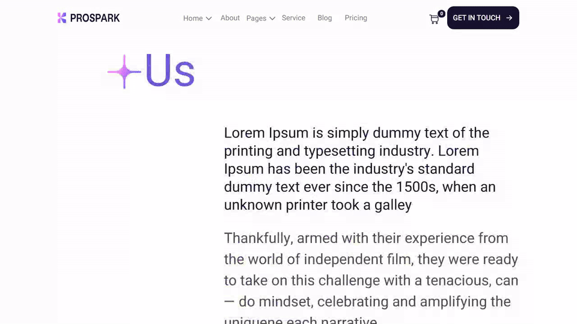
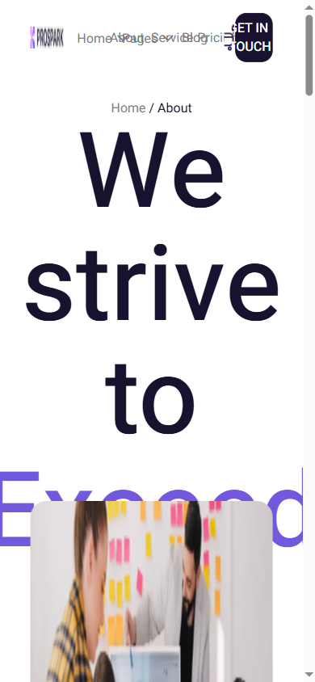
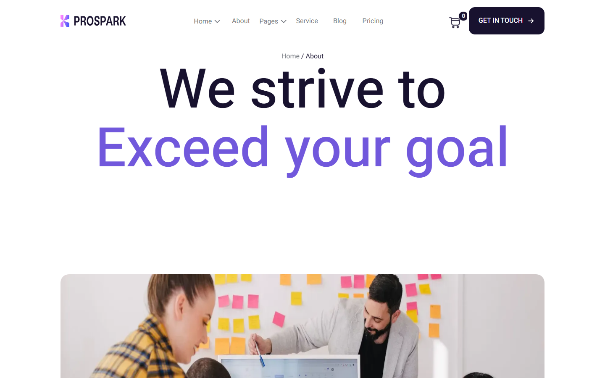
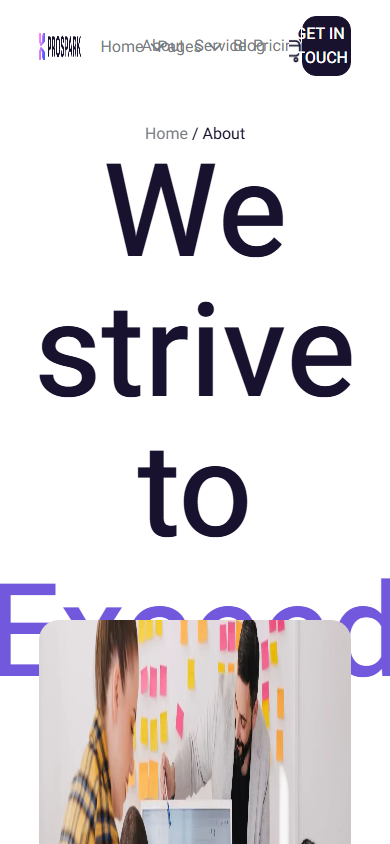

# Prospark-template

A two-page marketing agency template — landing page plus service detail page — with scroll-triggered AOS animations.

**Live demo:** <https://prospark-template.vercel.app/>

<div align="center">



| Desktop | Mobile |
|---|---|
|  |  |

<details>
<summary>More screenshots</summary>

| Desktop | Mobile |
|---|---|
|  |  |

</details>

</div>

## What it does

A hand-written reproduction of a commercial agency template: a landing page with hero, service boxes and a contact section, plus a dedicated service detail page. The exercise was matching a real design in plain HTML and CSS rather than starting from a blank page. Scroll entrance animations come from AOS `data-aos` attributes — fade, zoom and slide as elements enter the viewport — with no custom scroll code.

## Tech stack

React 19 · TypeScript · Vite

## Features

- Two pages sharing reusable component classes
- AOS scroll-triggered entrance animations
- Styles split into `style.css` (shared) and `service.css` (service page only)
- Responsive navigation with dropdown affordance
- SVG and WebP assets throughout

## Run locally

```bash
git clone https://github.com/Mister2314/Prospark-template.git
cd Prospark-template
npx serve .   # or just open index.html
```

Limitation: AOS loads from a CDN and there is no `prefers-reduced-motion` guard yet.
